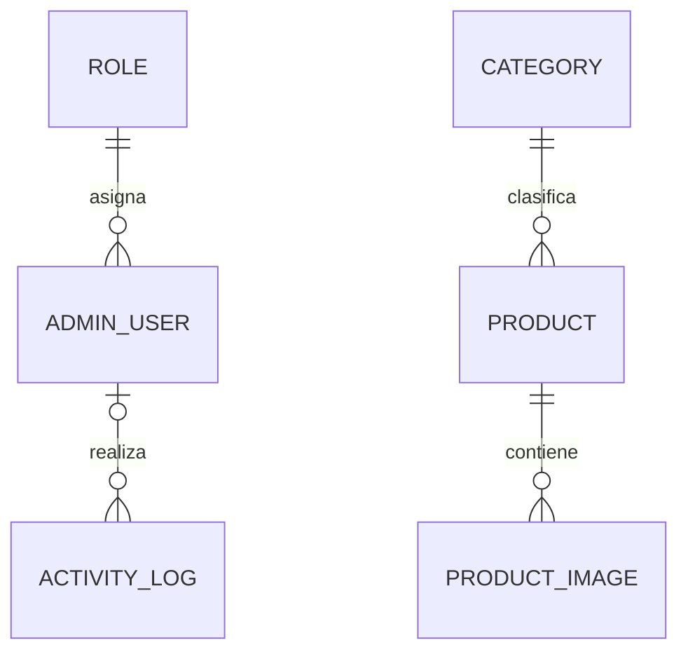

# Modelo de datos

## Diagrama entidad-relación

## Entidades y relaciones

- **Role**: roles administrativos `ADMIN` y `EDITOR`; un rol se asigna a varios usuarios.
- **AdminUser**: cuenta privada con correo único, hash de contraseña, estado y rol obligatorio. No hay autorregistro.
- **Category**: nombre y slug únicos; la desactivación oculta la categoría y sus productos del catálogo.
- **Product**: pertenece a una categoría; conserva descripción, material, precio opcional, moneda, disponibilidad y publicación. `deletedAt` permite eliminación lógica.
- **ProductImage**: varias imágenes por producto con URL y `cloudinaryPublicId`; el archivo no se guarda en PostgreSQL. Como máximo una imagen principal por producto.
- **Session**: almacenamiento PostgreSQL de sesiones del servidor, expirable e indexado por fecha de vencimiento.
- **ActivityLog**: historial de acciones; al eliminar una cuenta, la relación con el usuario se hace nula y el correo histórico se conserva.

## Integridad

El esquema define claves primarias y foráneas con reglas restrictivas para roles/categorías y cascada para imágenes al eliminar físicamente un producto. La migración agrega restricciones PostgreSQL para precio no negativo, precio requerido cuando se muestra y una imagen principal por producto.

Los precios usan `DECIMAL(12,2)` y `COP` como moneda inicial. El API nunca devuelve el valor de precio cuando `showPrice` es falso.

## Índices

Se indexan estado de usuarios, estado/nombre de categorías, categoría/publicación/actividad/eliminación de productos, imágenes por producto y orden, expiración de sesiones y búsquedas cronológicas de auditoría.
